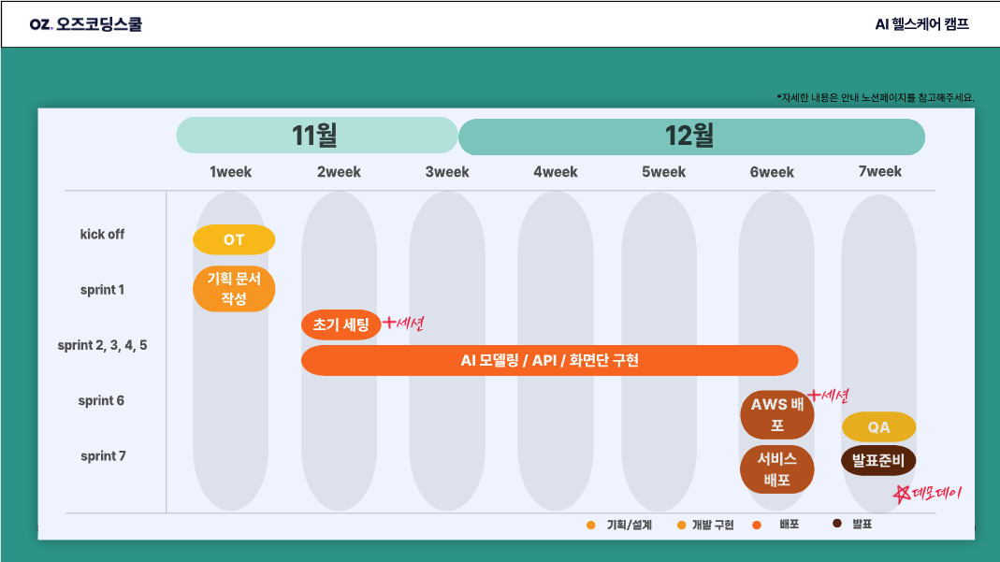

# 💊 필케어(PillCare) 팀 프로젝트

> 진료 기록 기반 복약 안내 및 생활습관 개선 가이드 자동 생성 시스템 개발  
> 의료 기록을 기반으로 개인 맞춤형 AI 복약 안내 및 건강 가이드를 자동으로 생성하는 웹 서비스

## 📌 1. 팀 및 프로젝트 기본 정보

| 구분 | 내용 |
|---|---|
| 팀명 | 필케어(PillCare) |
| 프로젝트명 | 진료 기록 기반 복약 안내 및 생활습관 개선 가이드 자동 생성 시스템 개발 |
| 프로젝트 유형 | AI 기반 헬스케어 웹 서비스 |
| 핵심 기술 | LLM, OCR, AI 챗봇 |

## 🎯 2. 프로젝트 배경 및 목적

진료 기록은 개인 맞춤형 의료 서비스를 구현하는 데 핵심적인 데이터입니다.

본 프로젝트에서는 LLM 기술을 활용하여 사용자의 진료 기록과 의료 정보를 분석하고, 개인의 건강 상태와 처방 내역에 맞는 복약 안내 및 생활습관 개선 가이드를 자동으로 제공하는 시스템을 개발하고자 합니다.

이를 통해 다음과 같은 문제 해결을 목표로 합니다.

- **개인별 복약 안내 제공:** 처방 내역을 바탕으로 개인 맞춤형 복약 정보 제공
- **환자 건강 모니터링 지원:** 진료 기록을 기반으로 건강 상태 관리 지원
- **생활습관 개선 가이드 제공:** 개인의 건강 상태에 맞는 생활습관 개선 방향 제안
- **AI 기반 의료 상담 챗봇 구현:** 사용자 질문에 맞는 건강 및 복약 관련 정보 제공

## ⚙️ 3. 주요 구현 기능

### 필수 구현 기능

| 기능 | 설명 |
|---|---|
| LLM 기반 안내 생성 | 진료 기록 및 처방 정보를 분석하여 개인 맞춤형 복약 안내와 건강 가이드 생성 |
| 실시간 챗봇 | 사용자와 AI 간 실시간 질의응답 기능 |
| OCR 기반 의료 정보 인식 | 의료 문서 및 처방전 이미지에서 텍스트와 의료 정보 추출 |

### 선택 구현 기능

| 기능 | 설명 |
|---|---|
| 시각·음성 콘텐츠 변환 | 복약 및 건강 안내 정보를 음성이나 시각 콘텐츠로 변환 |
| 이미지 분류 기반 의약품 분석 | 의약품 이미지를 분석하여 의약품 정보 제공 |
| 알림 기능 | 복약 시간 및 건강 관리 일정 알림 제공 |

## 🤝 팀 협업 규칙

원활한 프로젝트 진행을 위해 팀 운영 규칙과 Discord 채널 이용 규칙을 준수합니다.

📌 **[팀 운영 및 Discord 채널 이용 규칙 확인하기](docs/team_rules.md)**

## 📅 4. 프로젝트 개발 일정

